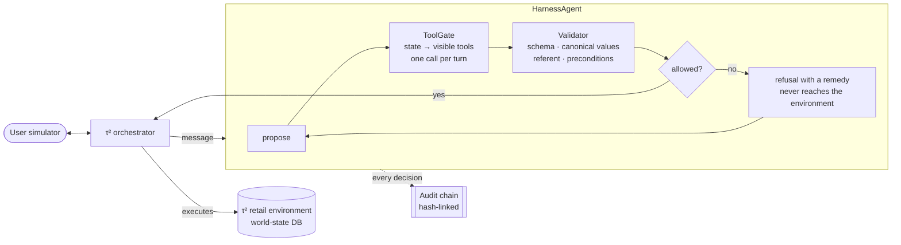

# PolicyGate

A reliability and audit harness for a policy-following agent, measured on
[τ²-bench](https://github.com/sierra-research/tau2-bench) retail.

**The question is not "can I build an agent".** It is: fix the model and the
user simulator, change only the harness, and measure what that is worth — with
the ablation, the intervals, and the failures that the measurement itself
turned up.

The answer, over 4158 simulations and $61.25: **the harness enforces the policy
completely and does not improve the task success rate.** Both halves are
reported below, along with two harness defects the audit trail caught while
being measured.

---

## What it does

τ²-bench scores an agent by hashing the world-state database after a
conversation. Its retail policy says, among other things, that the agent must
authenticate the user, check an order's status before acting on it, and make at
most one tool call per turn. Nothing in the benchmark checks whether the agent
obeyed any of that — only where the database ended up.

policygate sits between the model and the environment. Every proposed tool call
passes through it, and it can refuse.



The same modules run in a deployment where the approval is a real person rather
than a function call — the service turns the steps into a LangGraph graph whose
`interrupt` waits for an answer, and rebuilds the world by replaying the calls
it has executed.

---

## Results

Full report, with every number's provenance: **[`docs/w4_results.md`](docs/w4_results.md)**.
Design and pre-registration: [`docs/w4_design.md`](docs/w4_design.md).

114 retail tasks × 5 trials × 2 arms, no exclusions, no infrastructure errors.
`gpt-4.1-mini` for both the agent and the user simulator.

| | full harness | baseline | paired difference |
|---|---|---|---|
| reward pass^1 | 0.530 | 0.500 | **+0.030 [−0.018, +0.079]**, p = 0.25 |
| DB component | 0.574 | 0.551 | +0.023 [−0.028, +0.070] |
| one-call-per-turn violations | **0.000** | 0.737 | enforced by construction |
| assistant turns | 15.13 | 13.25 | +14% |
| cost per simulation | $0.0162 | $0.0141 | +15% |


*The same numbers in the dashboard. The run selector names the directory every
figure is read from, and the spend under it is that run's actual cost.*

Switching the seven mechanisms on one at a time, over all 114 tasks, puts none
of them past a multiple-comparison correction — and the arm that fires most,
one-call-per-turn (399 refusals), is where the extra turns come from. The arm
that never fires at all still scores +0.105, which is the honest measure of
this design's noise.


*`only_schema_check_enabled` — the arm whose rule never fired once — sits at
+0.105 with an interval that excludes zero. That is why no arm is read as an
effect here: a mechanism that refused nothing cannot have changed anything, so
+0.105 is this design's noise, not its second-best result.*

**The success-rate result is a null**, and the power analysis says why: this
design can detect +7.3pp, and the effect is about 3pp. What is not a null is the
compliance: the policy clause the harness enforces goes to zero violations, at
14% more turns and 15% more cost — and τ²-bench pays nothing for it, because the
grader looks only at the database. **11 of its own reference trajectories
violate the policy text** the harness enforces.

---

## What the measurement caught

The audit chain records every refusal with its rule, its reason and the call it
refused. Comparing those against each task's reference trajectory — not against
the total score — found two defects that were quietly costing the treatment arm
points:

1. **A rule that refused correct work.** The referent check compared a write's
   target against the last order looked up, so in multi-order tasks it refused
   the right order: 127 distinct writes refused, **107 of them reference
   actions**. Replaced with an ownership check the policy text actually states.
2. **Facts erased by a later lookup.** Reading the user's profile replaced what
   was known about an order, wiping the status the precondition check needs, and
   refused 12 writes whose status had been retrieved.


*How both defects were found. "Where to look" jumps to the first refusal and to
every call that was proposed and never reached the environment; the rule and the
arguments are on each record, so a refusal can be checked against what the task
actually required.*

Both runs were stopped and restarted rather than patched mid-flight; the
deviations, the evidence and the rules that were *not* changed are recorded in
[`docs/w4_design.md`](docs/w4_design.md).

A third finding came from the same trail and changed the design: a refusal that
says only *why* leaves the model stuck — 69 refused writes, 1 retried. Refusals
now carry the next action that would be accepted, and the share of refusals
followed by the reference action went **30% → 44%**, against 48% for errors the
environment itself returns.

---

## The dashboard

`make viz` opens nine pages over the runs in `experiments/`. Three of them exist
to stop a reader from being misled by the other six: every trace carries how
often its task passed in each arm, every arm carries its interval, and every
run names the code that produced it.


*A task the harness turned from 1/5 to 4/5, with the eleven proposals it refused
on the way. The banner above says how the other 113 tasks moved, so one good
pair cannot be mistaken for the result.*


*Where the tasks actually went. 51 of 114 are "sometimes" in both arms — the
noise the power analysis is about — and the refusal histogram shows
one-call-per-turn firing 1869 times against validation's 75.*

| Page | What it answers |
|---|---|
| Overview | What did the harness cost, and what did it buy |
| Paired trace | What did it do differently on one task |
| Single trace | What happened in one simulation, call by call |
| Ablation | Which mechanism is responsible |
| Failures | Where did the tasks move, and which rules fired |
| Audit chain | Is the record intact, and where did this one go wrong |
| Banking RAG · Retrieval | The retrieval study run on this harness ([policygate-rag](https://github.com/Jackson117/PolicyGate-rag)) |
| Live session | The harness working now, against the running service |

---

## A live session

The benchmark pages read runs that finished. This one is the same harness
working a turn at a time against the deployed service — a real person typing, a
real model proposing, and the approval gate holding a write until someone
answers.


*A customer asked to cancel a pending order. The harness let the two reads
through, and stopped at the write: the call has not run and will not run unless
a reviewer says so. `linked` is recomputed by the dashboard from the records
themselves rather than taken from the service that stores them.*

The retail backend is τ²'s environment with a fresh database per session, so
nothing here touches a real shop — but the person, the model and the harness are
real, and the decision path is the deployment's, not the benchmark's.

---

## Try it

```bash
# 1. The pinned benchmark checkout (third_party/PIN.md explains the pin)
git clone https://github.com/sierra-research/tau2-bench.git third_party/tau2-bench
git -C third_party/tau2-bench checkout a2c024725189473d2d7cea3a5cfdbcc67478e41f

# 2. Install and test -- the harness's own tests need no benchmark and no key
uv sync --extra bench --extra store --extra service --extra viz --extra dev
make test
```

```bash
# The dashboard over the runs in experiments/
make viz
```

```bash
# The deployment: approval service, dashboard, audit Postgres
docker compose up --build   # service :8000, dashboard :8501
```

Running an evaluation costs money and needs a provider key in `.env`
(copy `.env.example`). The full W4 plan is 1938 simulations, so start with
`--dry-run`, which prints the schedule and the estimate and spends nothing:

```bash
uv run python scripts/w4_run.py --budget 30 --out experiments/my_run --dry-run
```

---

## Layout

| Path | What is there |
|---|---|
| `src/policygate/harness/` | The contribution. Gating, validation, audit chain, approval gate, session state. **Imports no agent framework** — pydantic and the standard library only, enforced by `scripts/check_no_framework_deps.py` in CI |
| `src/policygate/adapters/` | The τ²-bench binding: tool catalogue, fact extraction, the `HarnessAgent` |
| `src/policygate/eval/` | pass^k with intervals, paired tests, violation rates, power analysis, and the budgeted chunked runner |
| `src/policygate/service/` | The deployment: LangGraph graph, human approval via `interrupt`, world rebuilt by replay |
| `src/policygate/store/` | The audit database — separate from τ²'s world state, always |
| `src/policygate/viz/` | Streamlit dashboard: headline, paired traces, ablation, failure migration, and the banking retrieval study run on this harness ([policygate-rag](https://github.com/Jackson117/PolicyGate-rag), read from its published `results/`) |
| `docs/` | [The five hard constraints](docs/constraints.md), findings, design and pre-registration, results |
| `experiments/` | Each run's plan and ledger: fingerprint, code identity, per-chunk spend |

8,900 lines of source, 6,000 of tests, 534 tests.

---

## Things worth knowing before reading the code

- **The harness is testable without an LLM.** Every rule is a pure function over
  a proposed call and the session's facts. That is why CI can run 276 of the
  tests with no benchmark, no network and no key.
- **Nothing is reported without an interval**, and no run is reported without
  its exclusions. A trace in the dashboard always carries how often its task
  passed in each arm, so the viewer cannot become a cherry-picking machine.
- **Each run directory records the code that produced it** — the committed trees
  of `harness/`, `adapters/`, `eval/` plus the tau2 commit. Resuming a run with
  different code is refused, and so is starting one with uncommitted changes.
