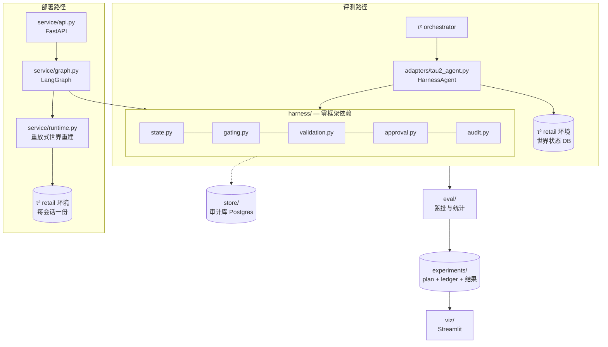
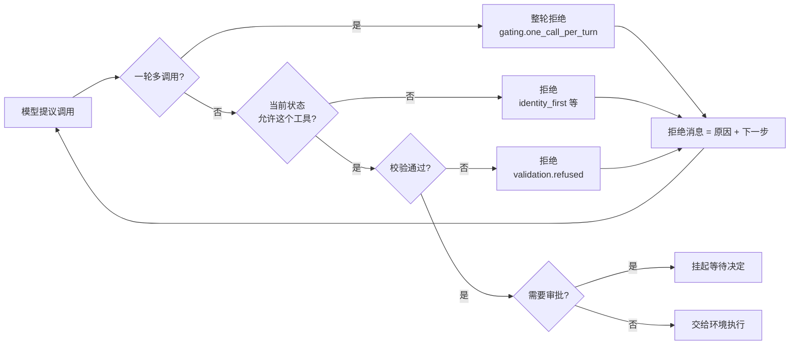
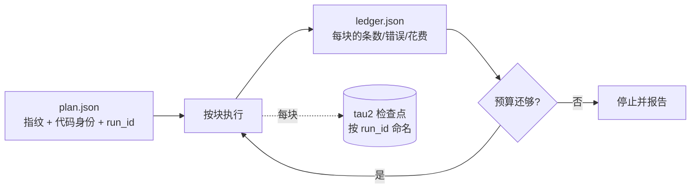
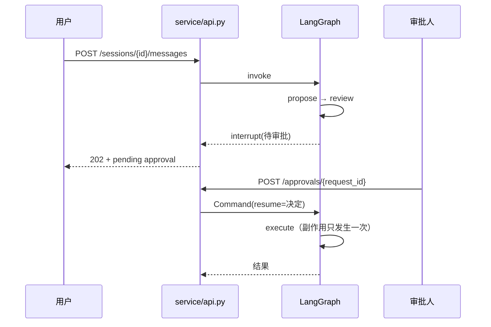

# 架构：实际建成的样子

本文描述**已经存在的代码**。原始设计稿里若干模块最终没有实现，第 6 节如实列出
它们和不实现的理由。每个模块名都可以在 `src/policygate/` 里找到对应文件。

---

## 1. 全景

**两条路径共用同一套 harness**。评测路径里审批是一次函数调用，部署路径里是一个
真人跨进程作出的决定——但门控、校验、审计走的是同一份代码，这是「部署的是被测过
的那套逻辑」这句话成立的前提。

---

## 2. harness/ — 项目的贡献所在

**硬约束：不许 import 任何 agent 框架**（LangGraph / LiteLLM / tau2 都不行），
只依赖 pydantic、deepdiff 和标准库。`scripts/check_no_framework_deps.py` 在 CI 里
强制检查，CI 还会在一个**完全没装这些框架**的环境里跑 176 个测试来证明这件事。

| 文件 | 职责 |
|---|---|
| `types.py` | 共享模型：`ToolCall` / `Decision` / `CheckFailure` / `AuditRecord` / `ClauseRef` |
| `config.py` | `HarnessConfig`：每个机制一个开关。消融的支点 |
| `state.py` | 会话状态与合法转移：`UNVERIFIED → VERIFIED → SCOPED`，加上 `PENDING_APPROVAL` 与终态 `TRANSFERRED` |
| `gating.py` | 状态 → 可见工具集；一轮一调用；每条拒绝归因到具体规则 |
| `validation.py` | 参数 schema、枚举值规范化、写操作对象的存在与归属、业务前置条件 |
| `approval.py` | 审批闸门与四种决策器（`auto_approve` / `auto_reject` / `oracle` / `noisy_oracle`） |
| `audit.py` | 哈希链：完整性、关联性、可验证顺序 |

### 一次提议的处理路径

**「下一步」是一个独立字段，不是拼在原因里的一句话。** W4 v3 的数据显示：只说原因
的拒绝，模型之后执行参考动作的比例是 30%，而环境自己报错时是 48%；69 次被拒的写
操作只有 1 次被重试。加上可执行的下一步后升到 44%（见 `w4_results.md` 第 3 节）。

### 审计链为什么不是日志

日志记录发生了什么，审计链**证明**发生了什么且未被篡改：每条记录挂上触发的规则与
政策条款、决定、以及上一条的哈希。追加写、有序、篡改即断链。
W4 两个 harness 缺陷都是靠「把每条拒绝与参考轨迹逐条比对」发现的，不是靠看总分。

---

## 3. adapters/ — 接 tau2

τ²-bench 拥有外层循环，**工具由环境执行，不由 agent 执行**。所以闸门拦在
「模型提议」与「返回 AssistantMessage」之间：被拒的调用根本不会到达环境，
它只以一条 tool 消息的形式回到模型的上下文里。

- `tau2_agent.py`：`HalfDuplexAgent` 的实现。提议 → 门控 → 校验 →（审批）→ 交付。
  被拒时在进程内重试，最多 `max_internal_attempts` 次，之后升级人工。
- `tool_mapping.py`：工具目录（kind 与 role）、调用转换、结果 → 事实提取、
  从 db.json 与 policy.md 推出的域约束。

---

## 4. eval/ — 跑批与统计

| 文件 | 职责 |
|---|---|
| `runner.py` | 分块跑批、预算闸、断点续跑、代码身份校验、会话记录落盘 |
| `passk.py` | pass^k 点估计与 bootstrap 区间；配对 sign-flip 检验；剔除策略 |
| `violations.py` | 政策条款违规率（harness 执行的与不执行的分别统计） |
| `power.py` | beta-binomial 拟合 + 功效模拟 + 最小可检测效应 |

跑批的三条设计，都是被真实事故逼出来的：

- **分块**：tau2 的批处理循环无法从外部中止，中断时它会 `os._exit`。所以每块自成
  一次 tau2 运行，预算与停止判断发生在块之间。
- **代码身份**：plan 指纹只覆盖实验配置，不覆盖代码。续跑时比对
  `harness/`、`adapters/`、`eval/` 的已提交树与 tau2 commit，不一致则拒绝续跑；
  代码未提交则拒绝启动。
- **检查点按 run_id 命名**：曾经按 plan 指纹命名，导致一次跑批直接读入了上一版
  代码的结果（`w4_design.md` 里作废的那次 v3 启动）。

---

## 5. service/ 与 store/ — 部署

benchmark 里审批是函数调用；部署里审批要**跨请求、跨进程**恢复，这正是
LangGraph `interrupt` + checkpointer 的用途。

两条关键性质：

- **被中断的节点恢复时会从头重跑**，所以 `await_approval` 在调用 `interrupt` 之前
  不做任何事，决定带来的副作用全在它之后。
- **世界状态不进 checkpoint**。已执行的工具调用按顺序记录，恢复时在一份新的数据库
  上重放重建。测试里由一个从没见过该会话的进程回复审批，第三个进程读回订单，
  状态正确。

`store/` 是**独立的审计库**，绝不碰 tau2 的世界状态 DB——评分靠世界状态哈希比对，
多写一个字节全部任务判负。写入按 (session, seq) 幂等，内容不同则拒绝覆盖。

---

## 6. 设计稿里有、最终没实现的

如实列出，因为 `HarnessConfig` 里仍留着它们的开关：

| 模块 | 状态 | 理由 |
|---|---|---|
| `idempotency.py` | 未实现，开关保留 | W1 在 90 条 simulation 里观测到 **0 次重复写调用**，这个域上它没有可作用的事件，消融行按构造为 0 |
| `retry.py`（失败分类重试） | 未实现 | 同上：需要先有证据表明分类能改变结果 |
| `compensation.py`（写失败回滚） | 未实现 | retail 的写操作由环境原子执行，没有观测到部分失败 |
| `guards.py`（循环守卫） | 未实现 | W1 零次非正常终止，没有可守的事件 |
| `context.py` | 合并进 `gating.py` | 按状态裁剪 schema 与门控共用同一份「状态 → 工具集」，拆成两个文件会让它们有各自的真相 |
| `eval/taxonomy.py`（失败八分类） | 未实现 | 分类器本身会成为一个需要验证的部件；改用「哪条规则触发了」这种可直接计数的证据 |
| `eval/ablation.py` | 合并进 `runner.py` | 消融就是 plan 里的一组臂，不需要单独的编排层 |

**开关留着而实现没写，是刻意的**：`HarnessConfig.full()` 不会打开它们，
所以不会出现「臂声称启用了某机制，而那个机制什么都没做」的错标行。
一旦某个域真的出现对应的失败，补上实现，消融表里自然多出一行。
